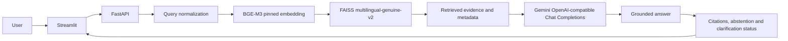
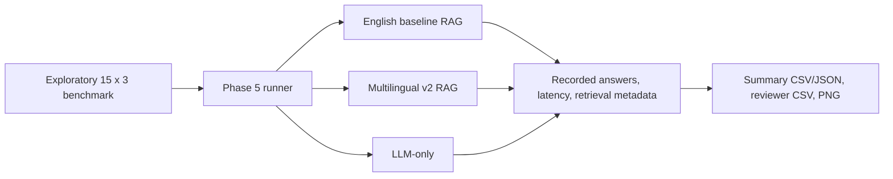

# FinRAG-Indic architecture

## Production chatbot



The user selects English, Hindi, or Tamil in Streamlit. FastAPI validates the
request, rejects likely credentials or excessively long questions, expands
supported financial abbreviations for retrieval only, and preserves the
original question in the generation prompt. BGE-M3 is pinned to revision
`5617a9f61b028005a4858fdac845db406aefb181`. The default index is the
269-vector `multilingual-genuine-v2` FAISS `IndexFlatIP` corpus.

Retrieved chunks retain document ID, title, source language, page, URL, score,
and extraction review flags. The grounding prompt instructs Gemini to use only
the supplied evidence, avoid credentials and personalized investment advice,
and emit resolvable `[S1]`-style markers. Invalid or missing markers cause
conservative abstention for non-abstained generated answers. Citation
resolution is provenance linkage, not proof of claim-level factual support.
Personalized decision questions remain abstained while the model may provide
evidence-grounded general education, identify missing inputs, and ask one
localized clarification question. Responses expose retrieval, generation,
citation-correction, and total latency separately.

## Corpus and index construction

```text
approved source manifest
  -> exact official URL acquisition and SHA-256
  -> PDF/HTML extraction and Unicode normalization
  -> page/section-aware chunks
  -> normalized BGE-M3 vectors
  -> FAISS IndexFlatIP
  -> checked vectors/chunks/metadata mapping
```

The immutable English baseline is `data/indexes/english` (107 chunks). The
production multilingual view is `data/indexes/multilingual-genuine-v2` (269
chunks). Index loading checks dimensions, counts, embedding revision, and chunk
mapping checksums. No Phase 6 work rebuilds either index.

## Evaluation pipeline



The runner uses the same configured Gemini provider and comparable generation
settings. LLM-only receives no evidence. English RAG uses the immutable
English index. Multilingual RAG uses `multilingual-genuine-v2`. Results are
appended incrementally to JSONL and can resume by canonical ID, language, and
condition. The benchmark translations and evidence mappings remain
`candidate_unverified`; reviewer score fields are intentionally blank.

## Component map

- [frontend/streamlit_app.py](../frontend/streamlit_app.py): demonstration UI.
- [src/finrag_indic/api/app.py](../src/finrag_indic/api/app.py): HTTP API.
- [src/finrag_indic/rag/service.py](../src/finrag_indic/rag/service.py): production orchestration.
- [src/finrag_indic/evaluation/query_normalization.py](../src/finrag_indic/evaluation/query_normalization.py): retrieval-only abbreviation expansion.
- [src/finrag_indic/evaluation/experimental.py](../src/finrag_indic/evaluation/experimental.py): Phase 5 conditions and metrics.
- [src/finrag_indic/providers/openai.py](../src/finrag_indic/providers/openai.py): Gemini-compatible async adapter.
